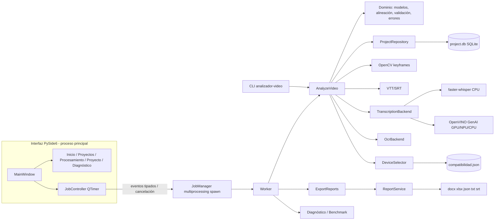

# Arquitectura

Monolito modular. La UI y la CLI consumen los mismos casos de uso; el motor no depende de Qt.

## Contratos
- **`dicho`**: `[HH:MM:SS.mmm - HH:MM:SS.mmm] Hablante: texto` (`domain/alignment.py`). Los reportes usan
  campos estructurados (`start_seconds`, `end_seconds`, `start_display`, `end_display`, `speaker`, `text`).
- **Alineación**: captura = `[t, t_siguiente)`; segmento incluido si `fin >= inicio_captura` y
  `inicio < fin_captura`; sin duración → fin del último segmento; nunca infinito.
- **Etapas**: `preparar → pantallas → audio → ocr → alinear → reporte`; dependencias en `STAGE_DEPENDENTS`.
  Recalcular una etapa invalida sus dependientes.
- **Eventos**: `JobStarted, StageStarted, StageProgress, WarningRaised, PartialResult, StageFinished, LogLine,
  JobFailed(UserMessage), JobFinished, DataResult` (`application/events.py`).
- **Errores**: `UserMessage(qué, qué afecta, ¿guardado?, acción, detalles)`; los tracebacks sólo van al log.
- **JSON de exportación**: `schema_version = 2`.
- **SQLite**: esquema v2 (`MIGRATIONS` en `infrastructure/persistence/database.py`), respaldo por migración.

## Decisiones
- `multiprocessing` (spawn) en vez de hilos: las librerías nativas no bloquean la UI y un fallo no la cierra.
- Un solo worker simultáneo para que Windows siga respondiendo.
- Dataclasses (no Pydantic) como estrategia única de modelos.
- Modo Automático = compatibilidad demostrada, no el dispositivo teóricamente más rápido.

## Próximo vertical slice recomendado
Revisión audiovisual (Fase 5): reproductor sincronizado (QtMultimedia), edición de OCR/transcripción con
`correction` (ya existe tabla y aplicación en reportes), undo/redo y reprocesamiento de una captura.
